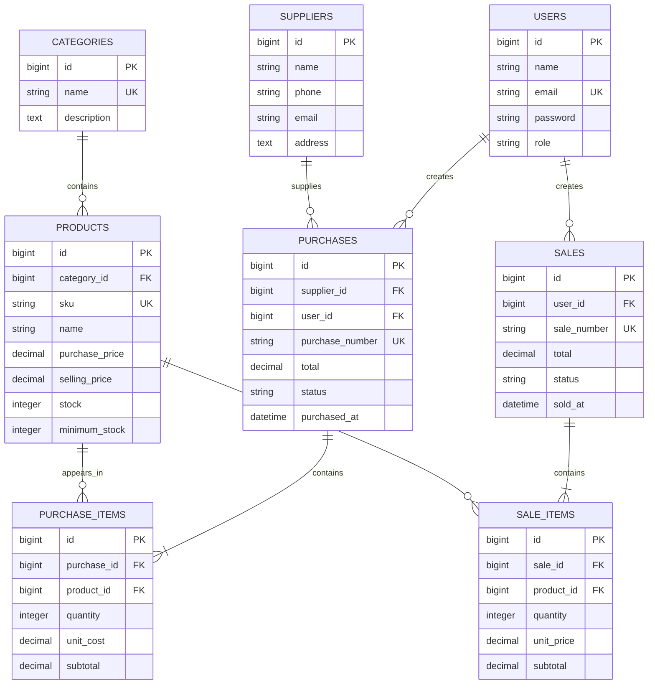

# ERD Inventory and Sales Management

Each purchase or sale has one header and one or more item rows. Each item stores the price used at the time of the transaction so later product price changes do not alter transaction history. Product and supplier records referenced by transactions are protected from hard deletion.
